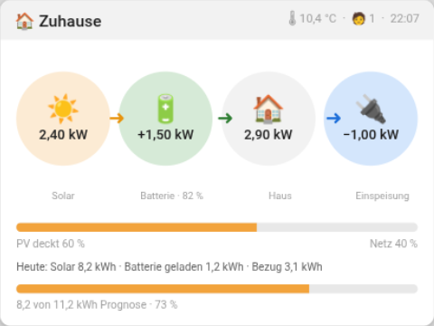
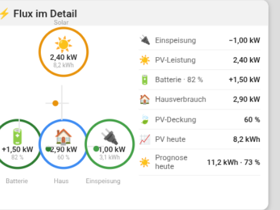

# LichtValley Flux

Electricity at home with solar **and a battery**: what the panels make, what the house uses, what the battery gives
or takes (with its state of charge), and what comes from the grid or goes back to it — on one tile, in the spirit of
Home Assistant's energy dashboard and the Power-Flux-Card look.

| The tile (2 × 3) | The card on a tap |
|---|---|
|  |  |

*Images with demonstration data — no real household values.*

**The tile** shows the sun, the battery, the house and the grid side by side: what the panels make now, what the
battery gives or takes, what the house uses, and what comes from the grid or goes back to it. Arrows show where the
power flows; a circle takes its colour while power flows there (amber for the sun, green for a charging battery, amber
for one that gives, blue for power from the grid, green for power to it). The battery's label carries its state of
charge („Batterie · 82 %"). Under them, when there is room:

- a bar of the house's use, amber as far as the sun covers it, blue for the rest („Solar deckt 46 %");
- the day so far („Heute: Solar 3,4 kWh · Bezug 5,2 kWh");
- what the panels made against today's forecast, as a bar.

It fits any size from 1 x 1 to 6 x 3. Without a battery sensor it falls back to the three-node view of hflocki's
energy_flow. **A tap** opens a card: at the left the flow as in Home Assistant's energy card (the sun above, battery,
grid and house below, joined by lines with a dot where power flows; the battery's ring carries its SoC), at the right
every chosen sensor in a row of its own.

## Set up

1. In Tessera, open **Plugins**, **Add with a link**, and paste the link of this repository. Add the plugin to a
   screen.
2. In the plugin's details on the screen's Plugins tab, under **When building**, choose the sensors:
   - **Grid power** (needed): your meter's power in W or kW, positive while power comes from the grid and negative
     while it goes back. A meter that counts the other way round: switch on **Invert the grid** on the tile.
   - **Solar power**: what the panels make now.
   - **Battery power**: what the battery gives (positive, discharge) or takes (negative, charge). A battery that
     counts the other way round: switch on **Invert the battery** on the tile.
   - **State of charge**: the battery's SoC in %.
   - **Solar today**, **Grid today**: today's energy in kWh, for the day so far.
   - **Solar coverage**: a sensor in % if you have one; without it the share is worked out from solar and grid.
   - **Forecast today**: today's solar forecast in kWh (Forecast.Solar, Solcast).
   Leave out what you do not have. **Save and build**.
3. In **Layout**, place the **Flux** tile.

## Good to know

- The house's use is grid + solar + battery. W and kW, Wh and kWh are both understood: the plugin reads each sensor's
  unit.
- Based on [hflocki/tessera-energy](https://github.com/hflocki/tessera-energy) (MIT), extended with the battery.

## Install for LichtValley

```
cd tessera-flux
git init && git add -A && git commit -m "LichtValley Flux v0.1.0"
gh repo create HatchetMan111/tessera-flux --public --source=. --push
```

Then in Tessera: **Plugins → Mit Link hinzufügen →** `https://github.com/HatchetMan111/tessera-flux`
→ Sensoren wählen → **Save and build**. Sensors for LichtValley:

| Input | Sensor |
|---|---|
| Netz-Leistung | `sensor.netzleistungnetto_wert_fur_nulleinspeisung` (Tibber, +Bezug/−Einspeisung) |
| PV-Leistung | `sensor.gesamt_hof_stromproduktion` |
| PV heute | `sensor.gesamttages_stromproduktion` |
| Prognose heute | `sensor.solcast_pv_forecast_prognose_heute` |
| Netzbezug heute | `sensor.gesamttagesstromverbrauchsensor_stromverbrauch_eingekauft` |
| Batterieleistung | `sensor.marstek_venus_modbus_batterieleistung` |
| Ladezustand | `sensor.marstek_venus_modbus_batterie_ladezustand` |

Tile options: **Netz umkehren** falls der Zähler invertiert zählt · **Batterie umkehren** falls Laden positiv zählt ·
**Tag anzeigen**.

## Bonus: Your home as a picture tile

The screen can show pictures straight from Home Assistant — no plugin needed. To put a picture of your own home (a
3D render, a photo) on a tile or as the screensaver's background:

1. Copy the picture into Home Assistant's config folder, e.g. `/config/images/home.png` (via the Samba share, or
   drag & drop in the Studio Code Server's explorer — uploads land on disk at once).
2. Add a local-file camera to `configuration.yaml`:

   ```yaml
   camera:
     - platform: local_file
       name: Home 3D
       file_path: /config/images/home.png
   ```

   If a `camera:` block already exists, only add the indented lines under it.
3. **Restart Home Assistant.** YAML-configured cameras load only at startup — a YAML reload from Developer tools is
   not enough.
4. In Tessera's layout, add a tile for `camera.home_3d`. At **full page** it fills the whole glass; it also works as
   the screensaver's **Camera** step (Screen settings → Screensaver), so the picture fills the screen in standby.

The picture stays completely local: it is read from your Home Assistant over your network and never leaves it.
